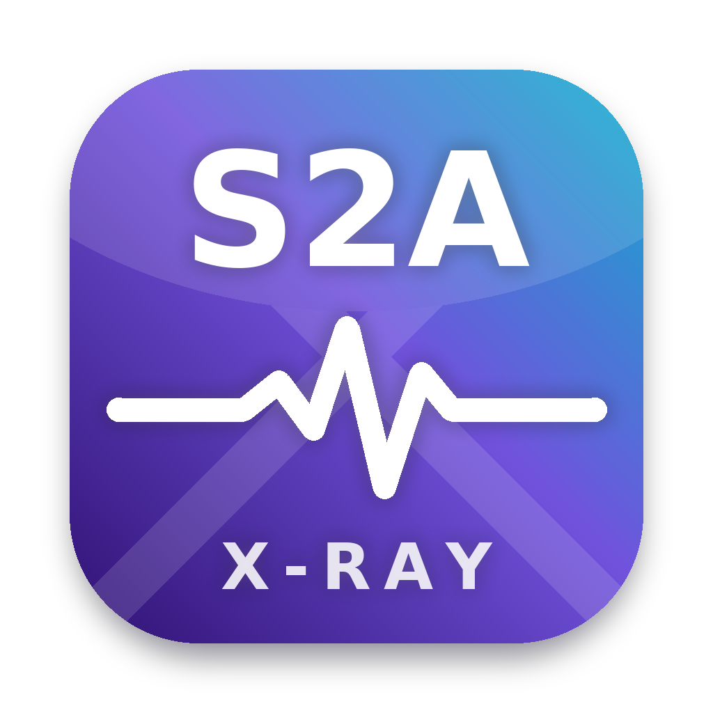

# S2A Claude X-Ray



Приложение для **macOS** и **Windows**, которое в реальном времени и по истории показывает, как вы используете **Claude Code**: сколько токенов уходит и на что, что Claude делает прямо сейчас и где можно сэкономить. На Mac оно нативное (SwiftUI), на Windows — то же приложение на Electron с теми же экранами, графиками и темой S2A (папка [`windows/`](windows)).

Сделано для подписки **Pro/Max**: суммы показываются как **API‑эквивалент**, то есть сколько те же токены стоили бы по прайс‑листу API. Деньги не списываются, но по этим цифрам видно, как быстро расходуются лимиты 5‑часового окна и недели.

## Возможности (MVP)

| Экран | Что показывает |
|---|---|
| **Сейчас** | Реальные лимиты аккаунта (5 часов и неделя) из Claude Code. Окно 5 часов по логам этого Mac: API‑эквивалент, время до сброса, прогноз, сравнение с вашим самым загруженным окном. Темп за последний час, сегодня, 7 дней, график по 5 минут, текущая сессия и её последние запросы |
| **Live‑трасса** | Что Claude делает прямо сейчас и что делал раньше: промпты, размышления (длительность), вызовы инструментов с командами и путями, результаты и ошибки, разрешения, субагенты, MCP, скиллы, контекст по шагам, поток ходов, таймлайн |
| **Обзор** | Итоги периода, стоимость по времени с разбивкой по моделям, из чего складывается стоимость (ввод, вывод, чтение и запись кэша), тепловая карта «день × час», доли моделей |
| **Сессии** | Таблица сессий с сортировкой и поиском; рост контекста и стоимость каждого запроса |
| **Проекты / Модели** | Рейтинг и таблица: запросы, токены, доля кэша, доля размышлений, стоимость |
| **Оптимизация** | Правила, которые находят дорогие места: низкая доля кэша, дорогая запись в кэш, сброс кэша после пауз, длинный контекст, перекос в сторону старших моделей (с расчётом «что если на Sonnet»), высокий effort, субагенты, одна сессия на весь бюджет, fast mode |
| **Отчёты** | Графический отчёт за период: обложка с итогом и сравнением с прошлым периодом, ключевые показатели, расход по дням и моделям, из чего складывается стоимость, проекты, самые дорогие сессии, доля кэша и размер контекста по дням, тепловая карта, рекомендации. Сохраняется в PDF (⌘S); данные — в Markdown и CSV |
| **Строка меню** | Процент 5‑часового лимита аккаунта, API‑эквивалент текущего окна и статус Claude прямо в строке меню |

Периоды: сегодня, 7, 30, 90 дней и всё время. Таблицу цен можно редактировать в «Настройки → Цены».

### Live‑трасса: что Claude делает прямо сейчас

Обновляется через 1–2 секунды после записи в лог. По умолчанию следует за самой активной сессией; любую сессию за последние 3 дня можно выбрать вручную. Показывает сессии, которые идут на этом Mac; облачные сессии сюда не попадают (см. [Ограничения](#ограничения)).

- **Статус в реальном времени:** «Выполняет Bash: `swift test` · 12 с», «Работает субагент (Explore) → Grep», «Думает», «Пишет ответ», «Ждёт вас», «Прервано», «Ошибка API». Рядом: сколько длится ход, сколько было ответов модели и вызовов инструментов, сколько инструментов работает параллельно, API‑эквивалент сессии, заполнение контекста и доля кэша последнего запроса. Тот же статус показывается в строке меню.
- **Лента:** каждое событие с точным временем. Промпты, сообщения, отправленные во время работы, размышления (длительность), ответы, вызовы инструментов (команда, файл, шаблон поиска, URL, MCP‑сервер, скилл, субагент) вместе с результатом, длительностью, ошибкой, размером вывода, строками `+/−`, способом разрешения (правило или классификатор auto mode) и временем генерации ввода. Для каждого ответа модели: контекст, кэш, ввод и вывод, размышления, стоимость. Есть фильтры, поиск и раскрытие полного текста.
- **Поток:** дерево каждого хода «промпт → ответы модели → инструменты → результаты → ответ» с итогами (время, токены, стоимость, исход хода) и карта переходов («Модель → Bash», «Bash → Модель», «Модель → MCP: github»…).
- **Таймлайн:** диаграмма Ганта ответов модели и инструментов (успех, ошибка, выполняется), промпты на той же оси, рост контекста по запросам, и куда ушло время: модель, инструменты, субагенты, ожидание вас.
- **Контекст:** заполнение окна (1M или 200K), модель и дата среза знаний, effort, TTL кэша, число сжатий. Оценка состава контекста: системный промпт, список скиллов, инструкции MCP, типы субагентов, отложенные инструменты и остальное. Разбивка каждого запроса на чтение кэша, запись в кэш и свежий ввод. Самые большие результаты инструментов, которые раздувают контекст. Окружение, разрешения, auto mode, файлы, изменённые вне Claude.
- **Инструменты · MCP · скиллы:** статистика по каждому инструменту (вызовы, ошибки, среднее и максимальное время, генерация ввода, объём вывода). MCP‑серверы и коннекторы со статусом (подключён, подключается, ошибка, нужна авторизация), числом инструментов, наличием инструкций и фактическими вызовами. Скиллы (доступные и вызванные), типы субагентов и их запуски, все прочитанные, записанные и изменённые файлы.
- Переключатель **«Скрыть содержимое»** убирает тексты промптов, команд и выводов, чтобы можно было показывать экран. Персональные данные из служебных записей (email, id организации) не читаются вообще.

### Лимиты аккаунта и облачные сессии

Логи облачных сессий (claude.ai/code, мобильное приложение Claude, облачная среда в Claude Desktop) и чатов остаются на серверах Anthropic, а публичного API, через который приложение на Mac могло бы их читать, у подписки Pro/Max нет. X‑Ray закрывает это двумя способами.

- **Реальные лимиты всего аккаунта.** Claude Code после каждого ответа передаёт своей строке статуса процент 5‑часового и недельного лимита ([`rate_limits`](https://code.claude.com/docs/en/statusline)). Эти цифры учитывают всё, что расходует подписку: чаты, облачные сессии, Cowork и сессии на этом Mac. В «Настройки → Лимиты аккаунта» нажмите «Подключить»: X‑Ray пропишет себя в `statusLine` файла `~/.claude/settings.json` (копия прежнего файла сохраняется как `settings.json.xray-backup`, своя строка статуса, если была, продолжает показываться). Цифры обновляются при каждом ответе Claude Code в Терминале на этом Mac, в том числе в сессии с Remote Control, и видны на экране «Сейчас» и в строке меню.
- **Импорт лога облачной сессии.** Попросите облачную сессию прислать свой лог («пришли лог сессии для X-Ray») и перетащите `.jsonl` или `.zip` в окно X‑Ray (или «Файл → Импортировать лог сессии…», ⌘I). Сессия появится со всеми токенами, инструментами и стоимостью на момент выгрузки. Импортированные логи лежат в `~/Library/Application Support/S2AClaudeXRay/imported`.

- **Облачные сессии вживую.** «Настройки → Облако» включает приёмник на этом Mac (только 127.0.0.1, с токеном доступа). Через туннель, например `tailscale funnel --bg 47318`, его видят облачные сессии. Скрипт `cloud/setup-environment.sh`, установленный в облачную среду, регистрирует хук `cloud/xray-push.py`: после каждого шага (промпт, вызов инструмента, конец ответа, субагент, сжатие) он отправляет новые строки лога сессии в X-Ray, а токен к запросу добавляет сетевой секрет облачной среды. X-Ray получает полный лог: контекст и его состав, токены каждого запроса, размышления в том виде, в каком их показывает приложение Claude, промпты, ответы и инструменты. Если Mac недоступен, хук досылает накопленное со следующим шагом.

Чтобы видеть сессию вживую без облака, запускайте её на Mac: `claude` в Терминале, локальная сессия в Claude Desktop или `claude remote-control` (управлять такой сессией можно из приложения Claude).

### Тема S2A

По умолчанию включена фирменная тема **S2A**: фиолетовый S2A, циан, глубокий ночной фон в тёмном режиме и мягкий лавандовый в светлом. В ней же иконка приложения и шапка в боковой панели. Восемь цветов графиков (фиолетовый, мятный, янтарный, циан, коралловый, синий, маджента, лайм) расставлены так, чтобы соседние серии различались при протанопии и дейтеранопии: худшая соседняя пара ΔE 8.7 в светлом и 8.8 в тёмном режиме при цели 8; при обычном зрении — 23.8 и 20.0 при минимуме 15. Статусные цвета (хорошо, внимание, серьёзно, критично) одинаковы во всех темах и всегда сопровождаются значком и подписью.

«Настройки → Оформление»: тема S2A или системная, режим как в системе, светлый или тёмный, превью палитры. Иконка генерируется скриптом `scripts/make-icon.py`.

## Скачать

Готовые сборки лежат в [Releases](../../releases): `S2A-Claude-X-Ray-<версия>.dmg` и `.zip`, универсальные (Apple Silicon + Intel), для macOS 14+.

Проще всего установить или обновить приложение из Терминала. Файл, скачанный через `curl`, не получает карантин, поэтому macOS не спрашивает подтверждения при запуске.

```bash
curl -L -o /tmp/S2A-Claude-X-Ray.zip https://github.com/x-daemon/claude-x-ray/releases/latest/download/S2A-Claude-X-Ray.zip
```

```bash
pkill -x S2AClaudeXRay; rm -rf "/Applications/S2A Claude X-Ray.app"; ditto -x -k /tmp/S2A-Claude-X-Ray.zip /Applications
```

```bash
open "/Applications/S2A Claude X-Ray.app"
```

Если ставите из DMG, скачанного браузером: сборка подписана ad‑hoc, поэтому при первом запуске откройте её через «Системные настройки → Конфиденциальность и безопасность → Всё равно открыть» или снимите карантин:

```bash
xattr -dr com.apple.quarantine "/Applications/S2A Claude X-Ray.app"
```

### Windows

Windows 10 и 11, x64 и ARM64. Скачайте и запустите установщик:

- [`S2A-Claude-X-Ray-Setup.exe`](https://github.com/x-daemon/claude-x-ray/releases/latest/download/S2A-Claude-X-Ray-Setup.exe) — x64 (обычные ПК и ноутбуки);
- `S2A-Claude-X-Ray-Setup-<версия>-arm64.exe` — ARM64 (Snapdragon), на странице [Releases](../../releases);
- `S2A-Claude-X-Ray-<версия>-win-x64.zip` / `-win-arm64.zip` — портативная версия без установки.

Или в PowerShell:

```powershell
Invoke-WebRequest https://github.com/x-daemon/claude-x-ray/releases/latest/download/S2A-Claude-X-Ray-Setup.exe -OutFile "$env:TEMP\S2A-Claude-X-Ray-Setup.exe"; Start-Process "$env:TEMP\S2A-Claude-X-Ray-Setup.exe"
```

Установщик ставит приложение для текущего пользователя (без прав администратора) в `%LOCALAPPDATA%\Programs\S2A Claude X-Ray`. Сборка не подписана сертификатом, поэтому Windows SmartScreen при первом запуске покажет «Система Windows защитила ваш компьютер»: нажмите «Подробнее» → «Выполнить в любом случае».

На Windows X-Ray живёт в области уведомлений (трее): щелчок по значку открывает сводку окна 5 часов и лимитов, закрытие главного окна не останавливает мониторинг. Логи читаются из `%USERPROFILE%\.claude\projects` (или `%CLAUDE_CONFIG_DIR%\projects`); для Claude Code в WSL добавьте папку `\\wsl$\<дистрибутив>\home\<пользователь>\.claude\projects` в «Настройки → Источники». Настройки и принятые логи облачных сессий лежат в `%APPDATA%\S2AClaudeXRay`.

Workflow **Release** (вручную или по тегу `v*`) прогоняет тесты, собирает DMG и ZIP для macOS (`scripts/package.sh`) и установщики для Windows (electron-builder на windows-latest) и публикует всё в одном релизе. Workflow **Windows** на каждом изменении `windows/` проверяет сборку, режим строки статуса, приём облачных логов и снимает все экраны и PDF-отчёт (ветка `snapshots-windows`).

## Как это работает

1. Claude Code пишет транскрипты сессий в `~/.claude/projects/<проект>/<сессия>.jsonl` (или в `$CLAUDE_CONFIG_DIR/projects`). У каждого ответа модели есть объект `usage`: ввод, вывод, чтение кэша, запись в кэш (TTL 5 мин / 1 ч), токены размышлений.
2. X‑Ray следит за папкой через FSEvents и дочитывает только новые байты, поэтому данные обновляются через 1–2 секунды после записи.
3. Один и тот же ответ модели записан в нескольких строках, по одной на каждый блок (thinking, text, tool_use). Повторы удаляются по `message.id + requestId`, иначе стоимость удвоилась бы или утроилась.
4. Стоимость считается по таблице цен: отдельно ввод, вывод, чтение кэша, запись кэша 5 мин (1.25× цены ввода) и 1 ч (2×), а также fast mode и веб‑поиск.

**Приватность:** приложение читает локальные файлы и никуда не обращается по сети. Вне своей папки оно меняет только `statusLine` в `~/.claude/settings.json`, и только после нажатия «Подключить».

## Сборка и запуск

Требования: macOS 14+, Xcode 15.3+ (Swift 5.10+).

```bash
swift run S2AClaudeXRay
```

Собрать `.app`:

```bash
./scripts/build-app.sh
```

```bash
open "build/S2A Claude X-Ray.app"
```

Сборка подписана ad‑hoc. При первом запуске откройте приложение через правый клик → «Открыть». Можно также открыть `Package.swift` в Xcode и запустить схему `S2AClaudeXRay`.

Тесты ядра:

```bash
swift test
```

CI (GitHub Actions, macOS) собирает пакет, гоняет тесты и прикладывает к каждому запуску готовый `S2A-Claude-X-Ray.zip`.

### Демо‑данные и скриншоты

Посмотреть приложение без своих логов:

```bash
python3 scripts/demo-data.py /tmp/xray-demo
```

```bash
CLAUDE_CONFIG_DIR=/tmp/xray-demo swift run S2AClaudeXRay
```

Скрипт создаёт неделю вымышленных сессий в трёх проектах и «живую» сессию. В ней видны MCP‑серверы (в том числе с ошибкой подключения и без авторизации), скиллы, субагент, сообщение, отправленное во время работы, падающий и затем проходящий тест и сборка, которая ещё идёт.

Workflow **Snapshots** (запуск вручную в Actions) собирает приложение, генерирует демо‑данные, снимает все экраны и вкладки трассы в светлой и тёмной теме и публикует PNG в ветку `snapshots`. Локально то же самое делает переменная `XRAY_SNAPSHOT_DIR=<папка>`.

## Структура

```
Sources/XRayCore        — ядро без UI (только Foundation): парсер логов, удаление повторов,
                          цены, аналитика, 5-часовые окна, трасса активности, правила оптимизации, экспорт
Sources/S2AClaudeXRay   — приложение SwiftUI + Swift Charts + MenuBarExtra
Tests/XRayCoreTests     — тесты ядра на синтетических транскриптах
scripts/build-app.sh    — сборка .app
windows/src/core        — то же ядро на TypeScript (тесты: npm test)
windows/src/main        — Electron: окна, трей, чтение логов, приём облачных логов, строка статуса
windows/src/renderer    — интерфейс (Preact + ECharts) с темой S2A, светлой и тёмной
windows/scripts/dev-server.ts — интерфейс в браузере на демо-данных, без Electron
```

Сборка Windows-версии (Node.js 22): `cd windows && npm ci && npm test && npm start`; установщики — `npm run dist` (на Windows).

## Ограничения

- **Окно по логам — приближение.** Pro/Max считают лимиты в 5‑часовых окнах. Размер лимита не публикуется и в логах не хранится, поэтому окно «по логам этого Mac» X‑Ray восстанавливает по активности и сравнивает с вашим историческим пиком. Точные проценты всего аккаунта даёт карточка «Лимиты аккаунта» (через строку статуса Claude Code); они обновляются, только когда Claude Code отвечает в Терминале на этом Mac.
- **Формат транскриптов внутренний** и может меняться между версиями Claude Code. Парсер нестрогий: неизвестные поля и типы пропускаются.
- **Цены нужно сверять** с [прайс‑листом](https://platform.claude.com/docs/en/about-claude/pricing). Модели, которых нет в таблице, оцениваются по своему семейству и помечаются.
- **Видны только сессии, которые идут на этом Mac.** Облачные сессии Claude Code (claude.ai/code, мобильное приложение Claude, облачная среда в Claude Desktop) выполняются на серверах Anthropic, и их логи остаются там. Чтобы X-Ray показывал сессию вживую, запустите её на Mac: `claude` в Терминале, сессия Code в локальной среде Claude Desktop или `claude remote-control` в папке проекта (тогда управлять ею можно из приложения Claude на телефоне или в браузере). Когда показывать нечего, X-Ray сам пишет, какие папки он читает, сколько в них логов и когда была последняя запись.

## Дальше

- Экспорт в PDF и еженедельный отчёт по расписанию.
- Тренды и сравнение периодов, цели по расходу.
- Разбор промптов через Claude API (по желанию, с отдельным API‑ключом).
- Admin API (Usage & Cost) — для тех, кто платит за API по токенам.
